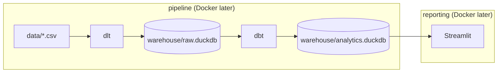

# MDS-in-a-box: Olist Data Stack Plan

## Goal

Turn the 9 Olist CSV files (~120 MB, ~1.5M rows) in [`data/`](data/) into a self-contained analytics stack that runs locally today and can be containerized later with minimal changes.



dlt writes **raw** only. dbt reads raw and writes **analytics**. Streamlit reads analytics only.

---

## MDS-in-a-box Principles (what we must respect)

These come from the [DuckDB MDS-in-a-box post](https://duckdb.org/2022/10/12/modern-data-stack-in-a-box.html) and the broader ecosystem (dlt, Dango, MotherDuck demos):

| Principle | How we apply it |
|-----------|-----------------|
| **Best-in-class OSS tools** | dlt + dbt + DuckDB + Streamlit — no proprietary warehouse |
| **SQL-first transformations** | Business logic lives in dbt models, versioned in git |
| **Local-first, zero cloud** | No AWS/GCP/Snowflake required for v1 |
| **Minimal ops** | Two `.duckdb` files as the warehouse; no DB server to manage |
| **Layered architecture** | `raw.duckdb` → dbt (`staging` + `marts`) → `analytics.duckdb` |
| **Reproducible** | One orchestration command rebuilds the full pipeline |
| **Independently portable** | Each tool works standalone if you outgrow the box |
| **Deployable everywhere** | Relative paths + env config so Docker is a thin wrapper later |
| **Dashboards as code** | Streamlit pages live in git (Python), not a click-ops BI UI |

---

## Hard Constraints to Design Around

1. **DuckDB single-writer per file** — dlt is the only writer of `raw.duckdb`. dbt is the only writer of `analytics.duckdb`. Streamlit is read-only on `analytics.duckdb`. Never run ingestion or dbt while Streamlit has an exclusive lock on analytics.

2. **Two DuckDB files, not one** — dlt targets `warehouse/raw.duckdb`. dbt attaches raw as a source and writes to `warehouse/analytics.duckdb`. Centralize both paths in `.env` / `profiles.yml`.

3. **Schema separation across files** — dlt loads into the `olist` schema inside `raw.duckdb` (DuckDB forbids a schema named `raw` in a file named `raw.duckdb` — catalog and schema would collide). dbt reads that, writes `staging` and `marts` into `analytics.duckdb`. Streamlit only queries `marts` (and optionally `staging` for debugging).

4. **Streamlit, not Metabase / Evidence** — No Java JAR, no community DuckDB driver, no Node BI app. Streamlit uses the DuckDB Python package. Open `analytics.duckdb` read-only.

5. **Static CSVs = full refresh** — Use `write_disposition="replace"` in dlt. No incremental/merge logic needed for v1.

6. **Geolocation is the heavy table** (~1M rows) — Use dlt's `read_csv_duckdb()` for fast ingestion, not plain Python CSV parsing.

7. **Olist data quirks belong in staging** — Handle in dbt, not Streamlit:
   - `customer_id` is per-order; `customer_unique_id` is the real customer
   - Timestamps are strings in CSV → cast in staging
   - `geolocation` joins on `zip_code_prefix`, not full zip
   - `product_category_name` is Portuguese → join `product_category_name_translation` in staging

8. **Generated artifacts stay out of git** — Add `warehouse/`, `.venv/`, `target/`, `dbt_packages/`, and `logs/` to [`.gitignore`](.gitignore).

9. **120 MB of CSVs in git** — Acceptable for a learning project, but note: for true "deploy anywhere" you may later swap to a `scripts/download_data.sh` (Kaggle API) and gitignore `data/`.

---

## Proposed Project Structure

```
mds-in-box/
├── data/                          # Olist CSVs (already present)
├── pipeline/
│   ├── pyproject.toml             # dlt + duckdb deps
│   └── olist_pipeline.py          # dlt: CSV → warehouse/raw.duckdb
├── dbt/
│   ├── dbt_project.yml
│   ├── profiles.yml               # path: warehouse/analytics.duckdb
│   │                              # attach: warehouse/raw.duckdb as `raw`
│   └── models/
│       ├── feeding/               # 1 model per source table, typed/renamed
│       │   ├── _sources.yml       # sources point at olist schema in raw.duckdb
│       │   ├── customer.sql
│       │   ├── orders.sql
│       │   ├── order_items.sql
│       │   └── product.sql
│       ├── intermediate/          # joins / business logic (not started)
│       └── marts/                 # analytics-ready tables for Streamlit
├── warehouse/                     # gitignored
│   ├── raw.duckdb                 # dlt output
│   └── analytics.duckdb           # dbt output
├── streamlit/                     # Streamlit app (Python pages)
│   ├── app.py                     # entrypoint
│   └── pages/                     # starter dashboards as code
├── scripts/
│   └── run.sh                     # ingest → dbt run → dbt test
├── .env.example                   # RAW_DUCKDB_PATH + ANALYTICS_DUCKDB_PATH
├── Makefile                       # make ingest | transform | streamlit | all
└── README.md
```

---

## Phase 1 — Ingestion (dlt)

**Pipeline design** ([`pipeline/olist_pipeline.py`](pipeline/olist_pipeline.py)):

- Destination: `dlt.destinations.duckdb("warehouse/raw.duckdb")`
- Dataset/schema: `olist` (not `raw` — that name collides with the `raw.duckdb` catalog)
- One dlt resource per CSV, with explicit table names matching filenames (e.g. `olist_orders_dataset`)
- Use `readers(bucket_url="data", file_glob="olist_orders_dataset.csv").read_csv_duckdb()` for performance
- `write_disposition="replace"` on every resource

**Table load order** (respects FK relationships conceptually, though DuckDB won't enforce during load):

1. `product_category_name_translation`, `olist_products_dataset`, `olist_sellers_dataset`, `olist_customers_dataset`
2. `olist_orders_dataset`
3. `olist_order_items_dataset`, `olist_order_payments_dataset`, `olist_order_reviews_dataset`
4. `olist_geolocation_dataset` (largest, load last)

---

## Phase 2 — Transformation (dbt)

**Tooling**: `dbt-duckdb` adapter, Python 3.11+.

**Two-database profile** — dbt's working database is `analytics.duckdb`; raw is attached read-only:

```yaml
# dbt/profiles.yml (sketch)
outputs:
  dev:
    type: duckdb
    path: ../warehouse/analytics.duckdb
    attach:
      - path: ../warehouse/raw.duckdb
        alias: raw
```

**Feeding layer** (`models/feeding/`) — one model per source table, light casts and renames only:
- Read via `{{ source() }}`, never from raw tables directly
- Cast timestamps to `TIMESTAMP`, money to `DECIMAL`
- Rename to snake_case (fix source typos like `lenght` → `length`)
- Document sources in `_sources.yml` pointing at the attached `olist` schema in `raw.duckdb`
- Intermediate and marts come later

**Marts layer** (`models/marts/`) — start small, high BI value:

| Model | Purpose |
|-------|---------|
| `fct_order_items` | Grain: one row per order line item. Joins orders, products, sellers. Revenue = price + freight |
| `dim_customers` | Deduplicated on `customer_unique_id` with order count, first/last order date |
| `dim_products` | Product attributes + English category |
| `mart_sales_daily` | Daily GMV, order count, avg ticket — main Streamlit time-series page |
| `mart_delivery_performance` | Actual vs estimated delivery days, by state |
| `mart_reviews` | Review scores by category and delivery timeliness |

**Tests** (dbt built-in):
- `unique` + `not_null` on primary keys in staging
- `relationships` test: `stg_order_items.order_id` → `stg_orders.order_id`

---

## Phase 3 — Visualization (Streamlit)

**Local setup** (no Docker yet):

1. Scaffold a Streamlit app in `streamlit/` (`app.py` + `pages/`)
2. Open `warehouse/analytics.duckdb` read-only via the DuckDB Python package
3. Query `marts` tables; keep SQL in the app thin — business logic stays in dbt
4. Run locally with `streamlit run streamlit/app.py` (default port 8501)

**Starter pages** (as code in git, not a BI UI):
- **Sales overview**: daily revenue trend, orders by state (map or bar)
- **Product performance**: top categories by revenue
- **Delivery & reviews**: avg review score vs delivery delay

Streamlit is a long-running server; start it separately from ingest/transform.

---

## Phase 4 — Orchestration

[`scripts/run.sh`](scripts/run.sh) (or Makefile targets):

```bash
# 1. Ingest → warehouse/raw.duckdb
python pipeline/olist_pipeline.py

# 2. Transform → warehouse/analytics.duckdb
cd dbt && dbt run && dbt test

# 3. Streamlit is started separately (long-running process)
```

Add a `make all` that runs ingest + transform. Document Streamlit as a separate `make streamlit` step since it's a persistent server.

---

## Phase 5 — Docker Compose (deferred, design now)

When ready, wrap without code changes. Two services match the two boxes in the architecture: pipeline (dlt + dbt + both DuckDB files) and reporting (Streamlit).

```yaml
services:
  pipeline:
    build: ./pipeline
    volumes: [./data:/data, ./warehouse:/warehouse]
    command: ["./scripts/run.sh"]

  streamlit:
    build: ./streamlit
    ports: ["8501:8501"]
    volumes: [./warehouse/analytics.duckdb:/warehouse/analytics.duckdb:ro]
    depends_on: [pipeline]
```

Key: volume-mount `warehouse/` so dlt and dbt share the two DuckDB files. Pipeline container exits after ingest+dbt. Streamlit stays running and mounts `analytics.duckdb` read-only.

---

## What We Are NOT Building (scope guard)

- No orchestrator (Airflow/Dagster) — a shell script is enough
- No MotherDuck/cloud warehouse — local DuckDB only for v1
- No real-time or incremental loads — static CSV full refresh
- No Metabase or Evidence — Streamlit pages as code only
- No authentication/RBAC — local dev only

---

## Success Criteria

- `./scripts/run.sh` loads all 9 tables into `warehouse/raw.duckdb` and runs dbt without errors
- dbt writes marts into `warehouse/analytics.duckdb`; `dbt test` passes on key models
- Streamlit connects to `warehouse/analytics.duckdb` and can query `mart_sales_daily`
- README documents: prerequisites, setup, run, and future Docker path
- Project structure is ready for `docker compose up` with zero Python/dbt code changes

---

## Implementation Checklist

- [x] Scaffold project: Python venv + pyproject.toml, .env.example, update .gitignore, Makefile *(dbt init still pending)*
- [x] Build dlt pipeline (`olist_pipeline.py`): load 9 CSVs into `warehouse/raw.duckdb` (`olist` schema)
- [x] Scaffold dbt project (`feeding` / `intermediate` / `marts`); feeding models for customer, orders, order_items, product
- [ ] Create dbt mart models (`fct_order_items`, `dim_customers`, `dim_products`, `mart_sales_daily`, `mart_delivery_performance`, `mart_reviews`) + tests — write to `analytics.duckdb`
- [ ] Add `scripts/run.sh` and Makefile targets (`ingest`, `transform`, `streamlit`, `all`)
- [ ] Scaffold Streamlit in `streamlit/`: DuckDB read-only → `analytics.duckdb`, three starter pages
- [ ] Write README with MDS-in-a-box principles, architecture diagram, quickstart, and future Docker notes
